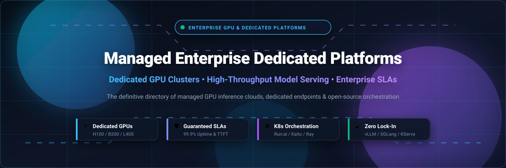

# 🚀 Awesome Managed Enterprise & Dedicated Platform Plans

<p align="center">
  
</p>

<p align="center">
  <a href="https://github.com/ishandutta2007/Awesome-Awesome-Awesome"></a>
  <a href="https://discord.gg/jc4xtF58Ve"></a>
  <a href="https://github.com/ishandutta2007/Awesome-Managed-Enterprise-Dedicated-Platform-Plans/stargazers"></a>
  <a href="https://github.com/ishandutta2007/Awesome-Managed-Enterprise-Dedicated-Platform-Plans/network/members"></a>
  <a href="https://github.com/ishandutta2007/Awesome-Managed-Enterprise-Dedicated-Platform-Plans/blob/main/LICENSE"></a>
  <a href="https://github.com/ishandutta2007/Awesome-Managed-Enterprise-Dedicated-Platform-Plans/pulls"></a>
  <a href="https://github.com/ishandutta2007"></a>
</p>

---

## 📖 Overview

The **Awesome Managed Enterprise & Dedicated Platform Plans** repository is the definitive, community-maintained directory of **enterprise GPU cloud infrastructure**, **managed dedicated model endpoints**, and **open-source Kubernetes inference orchestrators**.

When moving generative AI and deep learning workloads from prototype to mission-critical production, organizations quickly outgrow public serverless APIs due to token rate limits, noisy-neighbor variance, unpredictable latency spikes, and data privacy constraints. At the same time, managing raw bare-metal GPU clusters introduces massive operational overhead.

**Dedicated Platform Plans and Managed Enterprise Tiers** bridge this divide by delivering:
- ⚡ **Guaranteed GPU Throughput**: Dedicated H100, H200, B200, and L40S capacity reserved exclusively for your workloads.
- 🛡️ **Enterprise SLAs & Predictable Billing**: Strict Time-To-First-Token (TTFT) and token-generation latency contracts with fixed hourly or reserved capacity rates instead of volatile per-token surcharges.
- 🔒 **Data Privacy & VPC Peering**: Private network isolation, HIPAA/SOC 2 Type II compliance, and zero data-retention guarantees.
- 🔄 **Self-Hosted Kubernetes Alternatives**: Cloud-native, open-source serving stacks (vLLM, SGLang, KServe, Run:ai) that eliminate cloud vendor lock-in.

---

## 📑 Table of Contents

- [📊 Sector Overview & Market Dynamics](#-sector-overview--market-dynamics)
- [🏢 SaaS & Hosted Dedicated Platforms](#-saas--hosted-dedicated-platforms)
  - [Comparative Platform Matrix](#comparative-platform-matrix)
  - [Detailed Platform Profiles](#detailed-platform-profiles)
- [🔓 Open-Source Inference & Orchestration Stacks](#-open-source-inference--orchestration-stacks)
  - [Open-Source Solutions Ranked by Stars](#open-source-solutions-ranked-by-stars)
  - [Deep-Dive Project Profiles](#deep-dive-project-profiles)
- [🏗️ Architectural Blueprint: SaaS vs Self-Hosted](#️-architectural-blueprint-saas-vs-self-hosted)
- [🤝 How to Contribute](#-how-to-contribute)
- [📈 Star History](#-star-history)
- [💖 Support & Sponsorship](#-support--sponsorship)
- [⚖️ Disclaimer & License](#️-disclaimer--license)

---

## 📊 Sector Overview & Market Dynamics

The global enterprise AI infrastructure and dedicated inference platform market is projected to surge from **$12.8 Billion in 2024 to over $75.5 Billion by 2030**, reflecting a compound annual growth rate (**CAGR of ~34.4%**), driven by rapid enterprise LLM adoption, agentic workflow scaling, and private data compliance mandates.

From a competitive standpoint, the sector is **moderately fragmented**: while cloud hyperscalers (AWS, Microsoft Azure, Google Cloud) and semiconductor giants (NVIDIA, Groq) anchor baseline computing capacity, specialized inference cloud providers (Together AI, Fireworks AI, Anyscale, Baseten, Lepton) have carved out defensible latency, kernel-optimization, and pricing advantages. Furthermore, rapid innovation in the open-source ecosystem (notably vLLM, SGLang, and KServe) has democratized high-throughput serving architectures, actively preventing a single winner-take-all monopoly and fueling widespread adoption of hybrid, multi-cloud, and Bring-Your-Own-Compute (BYOC) infrastructure.

---

## 🏢 SaaS & Hosted Dedicated Platforms

The following platforms provide managed dedicated GPU capacity, custom private endpoints, enterprise Service Level Agreements (SLAs), and enterprise VPC peering.

### Comparative Platform Matrix

Sorted in descending order by **Company Valuation / Market Size**:

| 🏷️ Platform | 💰 Valuation / Company Size | 💳 Pricing (Specific Starting Rates) | 🎁 Free Tier Limit / Free Trial Terms | ⚡ Key Dedicated Focus & SLAs |
| :--- | :--- | :--- | :--- | :--- |
| **[Groq Cloud](#groq-cloud)** | **$2.8B** *(Series D, Aug 2024)* | **$0.05 / 1M tokens** (Llama 3.1 8B), **$0.59 / 1M tokens** (Llama 3.3 70B); Pro Tier: **$99/month** (100K requests incl., $0.001/req overage); Dedicated LPUs from ~$5,000/mo commit | **Free Forever Tier**: 1,000 requests/day, 30 RPM rate limits across open-weight models | Ultra-low latency LPU architecture; deterministic token speeds (>300 tok/s); enterprise custom racks |
| **[Together AI](#together-ai)** | **$1.25B - $3.0B** *(Series A/Valuation)* | Dedicated Model Inference (DMI): **$5.49/hr** per NVIDIA H100 SXM, **$8.99/hr** per NVIDIA B200 replica (per-minute billing); Serverless from **$0.18 / 1M tokens** | **Free Trial**: **$5.00 free credits** upon signup (valid for 90 days, ~27M tokens on 8B models) | Scale-to-zero support, only ready replicas bill; private cluster reservations; SOC 2 Type II certified |
| **[Anyscale Platform](#anyscale-platform)** | **$1.0B** *(Series C Unicorn)* | Hosted Compute: **$0.0135/hr** (CPU), **$0.5682/hr** (T4), **$4.9591/hr** (A100), **$9.2880/hr** (H100), **$10.6812/hr** (H200); BYOC Enterprise annual commitments | **Free Trial**: **$100 free compute credits** granted upon signup for testing Ray clusters and endpoints | Distributed computing foundation (Ray creators); Bring Your Own Cloud (BYOC) VPC deployment; marketplace billing |
| **[Fireworks AI](#fireworks-ai)** | **$552M** *(Series B, July 2024)* | Serverless: **$0.20 / 1M tokens** (8B), **$0.90 / 1M tokens** (70B); Dedicated GPU on-demand: **$4.50–$5.49/hr** (H100); 10%–30% volume discounts on enterprise annual commits | **Free Trial**: **$1.00 free credit** (~1M tokens on serverless models) upon signup, valid for 30 days | FireAttention custom kernels; multimodal support; sub-second TTFT SLAs; dedicated isolated instances |
| **[Replicate Deploy](#replicate-deploy)** | **$350M** *(Series B, a16z)* | Dedicated Hardware: **$0.81/hr** ($0.000225/s for T4), **$2.07/hr** (A40), **$5.04/hr** (A100 80GB), **$5.49/hr** (H100); per-second active/idle billing | **Free Trial**: **~50–100 free model predictions** upon GitHub authentication with zero upfront payment details | Open-source Cog packaging; dynamic scaling to zero for fine-tunes; isolated private hardware endpoints |
| **[Baseten](#baseten)** | **$220M** *(Series B, IVP)* | Dedicated Instances: **$0.60/hr** (A10G), **$4.85/hr** (A100 80GB), **$7.85/hr** (H100); Serverless from **$0.15 / 1M tokens**; custom enterprise commitments | **Free Trial**: **$30 free compute credits** granted upon account creation (valid for 30 days) | Truss open-source containerization; rapid cold-start optimizations (<2s boots); SOC 2, HIPAA, VPC peering |
| **[Abacus.ai](#abacusai)** | **$100M+** *(Raised $50M+, Series B)* | Pro Tier: **$20/month** (30,000 monthly credits + SuperComputer cloud instance at 1 credit / 5 min); App hosting: 320 credits/1K visits; DB: 300 credits/1M reqs | **Free Forever Tier**: **100 free credits** upon signup to test ChatLLM and AI Studio models | SuperComputer persistent compute; RouteLLM smart model routing; private fine-tuning and agent hosting |
| **[Lepton AI](#lepton-ai)** | **$50M - $100M** *(Series Seed/A, CRV)* | Dedicated GPU Cloud: **$0.60/hr** (L4), **$3.20/hr** (A100), **$4.90/hr** (H100); Serverless: **$0.07–$4.00 / 1M tokens** ($0.50/1M on Mixtral 8x7B) | **Free Trial**: **$10 free compute credits** upon phone/email verification; basic tier rate-limited to 10 RPM | Photon micro-containers (`lep run`); single-command deployment; custom SLAs with enterprise contracts |
| **[DeepInfra](#deepinfra)** | **$30M - $50M** *(Profitable, >$10M ARR)* | Flex Tier (0.8× base): **$0.05 / 1M tokens** (8B), **$0.27 / 1M tokens** (70B); Standard (1.0×), Priority (1.5×); Dedicated GPU rental with 200 concurrent req ceiling | **Free Trial**: **$1.80 free trial credit** on signup (~36M input tokens on Llama 3 8B, no credit card required) | Native FP4 quantization support; SOC 2 and ISO 27001 certified; high-density batch and embedding serving |
| **[Chutes](#chutes)** | **$15M - $30M** *(Early-stage Seed)* | Plus Tier: **$10/month** (5× PAYG compute value); Pro Tier: **$20/month** (10× PAYG value); Enterprise: custom billing with volume discounts and rolling time-window caps | **Free Forever Tier**: **10 free inference requests/day** on standard models without payment details | Confidential computing on hardware TEEs; decentralized verifiable GPU compute; zero data snooping |

---

### Detailed Platform Profiles

#### Groq Cloud
- **Website**: [groq.com](https://groq.com/)
- **Pricing Details**: Pro tier at **$99/month** (100K requests included, $0.001/req overage). Pay-as-you-go tokens start at **$0.05 per million tokens** (Llama 3.1 8B) up to **$0.59 per million tokens** (Llama 3.3 70B). Dedicated LPU racks available by enterprise quotation.
- **Free Tier**: Free forever tier provides **1,000 requests per day** with up to 30 requests/minute.
- **Enterprise Features**: Powered by proprietary Language Processing Units (LPUs) achieving deterministic, ultra-fast generation (>300–500 tokens/sec). Offers enterprise SLAs, dedicated multi-tenant clusters, and strict data confidentiality.

#### Together AI
- **Website**: [together.ai](https://www.together.ai/)
- **Pricing Details**: Dedicated Model Inference (DMI) billed by the minute per ready replica: **$5.49/hour** for NVIDIA H100 SXM, **$8.99/hour** for NVIDIA B200. Provisioning, cold starts, and degraded states are non-billable. Serverless per-token starting at **$0.18/1M tokens**.
- **Free Tier**: **$5.00 free credit** on sign-up valid for 90 days.
- **Enterprise Features**: Set `minReplicas` and `maxReplicas` to enforce hard cost floors and ceilings. Full scale-to-zero capability. SOC 2 Type II compliant, reserved GPU capacity with volume discount schedules.

#### Anyscale Platform
- **Website**: [anyscale.com](https://www.anyscale.com/)
- **Pricing Details**: Transparent compute instance-hour pricing: CPU from **$0.0135/hr**, NVIDIA T4 at **$0.5682/hr**, L4 at **$0.9542/hr**, A10G at **$1.3635/hr**, A100 at **$4.9591/hr**, H100 at **$9.2880/hr**, H200 at **$10.6812/hr**.
- **Free Tier**: **$100 free credit grant** upon account creation for cluster and model testing.
- **Enterprise Features**: Creators of open-source Ray. Bring Your Own Cloud (BYOC) executes workloads directly within your existing AWS or GCP VPCs, leveraging pre-negotiated cloud commitments and enterprise security frameworks.

#### Fireworks AI
- **Website**: [fireworks.ai](https://fireworks.ai/)
- **Pricing Details**: Six tiered plans spanning Serverless, Fine-Tuning, and Dedicated On-Demand. Base serverless tokens range from **$0.20 to $0.90 per million tokens**. Dedicated H100 instances from **$4.50 to $5.49/hr**. Committed spend contracts receive **10%–30% volume discounts**.
- **Free Tier**: **$1.00 free credit** (~1M tokens) provided upon sign-up, usable across serverless inference.
- **Enterprise Features**: Proprietary FireAttention kernels delivering ultra-fast inference and streaming. Dedicated GPU hardware isolation, low-latency function calling, and structured JSON generation.

#### Replicate Deploy
- **Website**: [replicate.com](https://replicate.com/)
- **Pricing Details**: Private dedicated instances billed strictly by the second: Nvidia T4 at **$0.000225/s ($0.81/hr)**, A40 at **$0.000575/s ($2.07/hr)**, A100 (80GB) at **$0.001400/s ($5.04/hr)**, and H100 at **$0.001525/s ($5.49/hr)**.
- **Free Tier**: **50–100 free trial predictions** upon authenticating with a GitHub account.
- **Enterprise Features**: Turnkey packaging using open-source Cog. Dedicated endpoints auto-scale from zero to tens of instances based on live incoming request volumes.

#### Baseten
- **Website**: [baseten.co](https://www.baseten.co/)
- **Pricing Details**: Dedicated GPU instances starting from **$0.60/hr** (A10G) to **$4.85/hr** (A100 80GB) and **$7.85/hr** (H100 SXM) with per-second billing and scale-to-zero. Pay-per-token serverless available from **$0.15/1M tokens**.
- **Free Tier**: **$30 free compute credits** granted upon account registration (valid for 30 days).
- **Enterprise Features**: Powered by open-source Truss. Advanced cold-start mitigation techniques (<2 second container boots), SOC 2 Type II and HIPAA compliance, and direct VPC peering across AWS and GCP.

#### Abacus.ai
- **Website**: [abacus.ai](https://abacus.ai/)
- **Pricing Details**: Pro tier at **$20/month total**, including **30,000 monthly credits**, full AI Agent studio access, and always-on **SuperComputer** cloud instances (1 credit per 5 minutes runtime). App hosting at 320 credits/1K visits; databases at 300 credits/1M requests.
- **Free Tier**: Free tier gives **100 credits** on registration without requiring credit card details.
- **Enterprise Features**: Turnkey orchestration for multi-agent systems, automated model routing with RouteLLM, and enterprise-grade dedicated model fine-tuning.

#### Lepton AI
- **Website**: [lepton.ai](https://www.lepton.ai/)
- **Pricing Details**: Serverless inference starting from **$0.07 to $4.00 per million tokens** (e.g., Mixtral 8x7B at $0.50/1M tokens). Dedicated GPU instances start from **$0.60/hr** (L4), **$3.20/hr** (A100), and **$4.90/hr** (H100).
- **Free Tier**: **$10 free compute credits** granted upon email and phone verification.
- **Enterprise Features**: Containerized Photon architecture deploying local Python code into production cloud endpoints via a single command (`lep run`). Offers custom SLA contracts and private VPC connectivity.

#### DeepInfra
- **Website**: [deepinfra.com](https://deepinfra.com/)
- **Pricing Details**: Service multiplier tiers: Flex (0.8× base, $0.05/1M tokens for 8B models), Standard (1.0×), and Priority (1.5×). Dedicated GPU rentals with a 200 concurrent request ceiling. Embeddings starting at **$0.005–$0.01 per million tokens**.
- **Free Tier**: **$1.80 free trial credit** provided upon sign-up (covers ~36M input tokens on Llama 3 8B).
- **Enterprise Features**: Specialized FP4 quantization across flagship open-weights models to slash token serving costs. ISO 27001 and SOC 2 Type II certified.

#### Chutes
- **Website**: [chutes.ai](https://chutes.ai/)
- **Pricing Details**: Subscription tiers: Plus at **$10/month** (5× PAYG compute value) and Pro at **$20/month** (10× PAYG compute value). Enterprise tier includes custom billing, tailored rate limits, and volume discounts.
- **Free Tier**: Free community tier with a rate limit of **10 free requests per day** on public endpoints.
- **Enterprise Features**: Confidential compute infrastructure running on hardware Trusted Execution Environments (TEEs) ensuring cryptographic privacy for proprietary model weights and input prompts.

---

## 🔓 Open-Source Inference & Orchestration Stacks

For platform engineers prioritizing data sovereignty, low-latency on-premises deployments, and zero vendor lock-in, the open-source ecosystem provides battle-tested model serving engines, distributed schedulers, and Kubernetes operators.

### Open-Source Solutions Ranked by Stars

The table below is sorted in descending order by **GitHub_Stars**:

| 🌟 Repository & Project | 🏷️ Stars_Badge *(Social)* | ⚙️ Primary Role & Runtime | 📄 License | 🎯 Target Workload |
| :--- | :--- | :--- | :--- | :--- |
| **[Ollama](https://github.com/ollama/ollama)** | [](https://github.com/ollama/ollama/stargazers) | Self-Hosted Model Runner / CLI | MIT | Local development, private workstation & internal edge AI |
| **[vLLM](https://github.com/vllm-project/vllm)** | [](https://github.com/vllm-project/vllm/stargazers) | High-Throughput Serving Engine | Apache 2.0 | High-concurrency enterprise LLM inference with PagedAttention |
| **[LocalAI](https://github.com/mudler/LocalAI)** | [](https://github.com/mudler/LocalAI/stargazers) | Multi-Model Drop-in OpenAI API | MIT | On-prem multimodal serving across CPU, GPU, and edge |
| **[Ray (Ray Serve)](https://github.com/ray-project/ray)** | [](https://github.com/ray-project/ray/stargazers) | Distributed Compute & Serving Mesh | Apache 2.0 | Scalable multi-model composition and distributed inference |
| **[SGLang](https://github.com/sgl-project/sglang)** | [](https://github.com/sgl-project/sglang/stargazers) | High-Performance Serving & Runtime | Apache 2.0 | RadixAttention KV-cache reuse, structured JSON decoding |
| **[TensorRT-LLM](https://github.com/NVIDIA/TensorRT-LLM)** | [](https://github.com/NVIDIA/TensorRT-LLM/stargazers) | GPU Kernel Compiler & Runtime | Apache 2.0 | Maximum hardware throughput on NVIDIA H100 / B200 GPUs |
| **[Triton Inference Server](https://github.com/triton-inference-server/server)** | [](https://github.com/triton-inference-server/server/stargazers) | Enterprise Multi-Model Server | BSD 3-Clause | Heterogeneous production serving across PyTorch, ONNX, and LLMs |
| **[Text Generation Inference (TGI)](https://github.com/huggingface/text-generation-inference)** | [](https://github.com/huggingface/text-generation-inference/stargazers) | Production LLM Serving Server | Apache 2.0 | Turnkey Hugging Face model deployment with continuous batching |
| **[SkyPilot](https://github.com/skypilot-org/skypilot)** | [](https://github.com/skypilot-org/skypilot/stargazers) | Multi-Cloud AI Compute Orchestrator | Apache 2.0 | 3x–5x GPU cost reduction via automatic multi-cloud failover |
| **[Xinference](https://github.com/xorbitsai/inference)** | [](https://github.com/xorbitsai/inference/stargazers) | Distributed Model Inference Cluster | Apache 2.0 | Turnkey distributed deployment of LLM, speech, and multimodal |
| **[BentoML](https://github.com/bentoml/BentoML)** | [](https://github.com/bentoml/BentoML/stargazers) | Unified AI Model Serving Framework | Apache 2.0 | Adaptive batching, multi-model execution graphs, Python microservices |
| **[ClearML (ClearML Serving)](https://github.com/clearml/clearml)** | [](https://github.com/clearml/clearml/stargazers) | MLOps & Model Serving Suite | Apache 2.0 | Automated model registry sync, canary rollouts, CI/CD pipelines |
| **[KServe](https://github.com/kserve/kserve)** | [](https://github.com/kserve/kserve/stargazers) | Kubernetes Model Serving Operator | Apache 2.0 | Cloud-native serverless inference, Knative scale-to-zero, canary |
| **[GPUStack](https://github.com/gpustack/gpustack)** | [](https://github.com/gpustack/gpustack/stargazers) | Lightweight GPU Cluster Manager | Apache 2.0 | Heterogeneous GPU pooling (Apple Silicon, NVIDIA, AMD) |
| **[Seldon Core](https://github.com/SeldonIO/seldon-core)** | [](https://github.com/SeldonIO/seldon-core/stargazers) | Cloud-Native MLOps Framework | Apache 2.0 | Complex inference graphs, model explainability, traffic routing |
| **[Lorax](https://github.com/predibase/lorax)** | [](https://github.com/predibase/lorax/stargazers) | Multi-LoRA Inference Engine | Apache 2.0 | Serving thousands of fine-tuned adapters on a single GPU |
| **[KAI Scheduler (Run:ai)](https://github.com/kai-scheduler/KAI-Scheduler)** | [](https://github.com/kai-scheduler/KAI-Scheduler/stargazers) | Kubernetes Native AI Scheduler | Apache 2.0 | Gang scheduling, fractional GPU slicing with hard memory isolation |
| **[Truss](https://github.com/basetenlabs/truss)** | [](https://github.com/basetenlabs/truss/stargazers) | Model Packaging & Serving Framework | Apache 2.0 | Standardized model packaging with fast container rebuilds |
| **[Kaito](https://github.com/kaito-project/kaito)** | [](https://github.com/kaito-project/kaito/stargazers) | Kubernetes AI Toolchain Operator | Apache 2.0 | Auto-provisioning GPU node pools and preset vLLM runtimes |

---

### Deep-Dive Project Profiles

#### 1. [Ollama](https://github.com/ollama/ollama)
[](https://github.com/ollama/ollama/stargazers)
- **Primary Use Case**: Frictionless local and internal model execution.
- **Key Capabilities**: Bundles model weights, configurations, and quantization parameters into an easily shareable Modelfile. Features a standardized REST API conforming to OpenAI specifications, enabling engineering teams to prototype locally and seamlessly transition to dedicated clusters.

#### 2. [vLLM](https://github.com/vllm-project/vllm)
[](https://github.com/vllm-project/vllm/stargazers)
- **Primary Use Case**: The high-throughput backbone for enterprise inference platforms.
- **Key Capabilities**: Introduces **PagedAttention** to eliminate memory fragmentation in KV-caches. Offers continuous batching, chunked prefill, speculative decoding, multi-GPU tensor parallelism, and native FP8/FP4 support across thousands of open-source model architectures.

#### 3. [LocalAI](https://github.com/mudler/LocalAI)
[](https://github.com/mudler/LocalAI/stargazers)
- **Primary Use Case**: Self-hosted drop-in OpenAI replacement for multi-modal intelligence.
- **Key Capabilities**: Operates without requiring dedicated GPUs, running effectively across consumer hardware, on-prem servers, and Kubernetes. Handles text generation, audio transcription, image generation, and vector embeddings in a single unified binary.

#### 4. [Ray (Ray Serve)](https://github.com/ray-project/ray)
[](https://github.com/ray-project/ray/stargazers)
- **Primary Use Case**: Enterprise-scale distributed AI computing and multi-model pipelines.
- **Key Capabilities**: Foundation for Anyscale Platform and production systems at OpenAI. Provides Ray Train, Tune, Data, and **Ray Serve** for composing complex inference pipelines with independent autoscaling, fractional GPU sharing, and zero-downtime rolling upgrades.

#### 5. [SGLang](https://github.com/sgl-project/sglang)
[](https://github.com/sgl-project/sglang/stargazers)
- **Primary Use Case**: High-concurrency agentic workflows and structured generation.
- **Key Capabilities**: Implements **RadixAttention** for automatic KV-cache reuse across multi-turn prompts and tree-search decodings. Delivers significant throughput speedups for complex LLM agents, chain-of-thought workflows, and constrained JSON decoding.

#### 6. [TensorRT-LLM](https://github.com/NVIDIA/TensorRT-LLM)
[](https://github.com/NVIDIA/TensorRT-LLM/stargazers)
- **Primary Use Case**: Maximum hardware-accelerated throughput on NVIDIA Silicon.
- **Key Capabilities**: Compiles state-of-the-art LLMs with custom CUDA kernels, in-flight batching, tensor parallelism, and FP8/FP4 quantization. Ideal for enterprise data centers operating dedicated NVIDIA H100, H200, and Blackwell B200 clusters.

#### 7. [Triton Inference Server](https://github.com/triton-inference-server/server)
[](https://github.com/triton-inference-server/server/stargazers)
- **Primary Use Case**: Multi-framework enterprise inference gateway.
- **Key Capabilities**: Serves models built with PyTorch, TensorFlow, TensorRT, ONNX, and vLLM simultaneously. Implements dynamic batching, model concurrent execution, ensemble pipelines, and enterprise telemetry metrics for Prometheus and Grafana.

#### 8. [Text Generation Inference (TGI)](https://github.com/huggingface/text-generation-inference)
[](https://github.com/huggingface/text-generation-inference/stargazers)
- **Primary Use Case**: Turnkey production serving for open-weights Hugging Face models.
- **Key Capabilities**: Production engine backing Hugging Face Dedicated Endpoints. Features tensor parallelism, flash attention, continuous batching, watermarking, token streaming, and turnkey OCI container images.

#### 9. [SkyPilot](https://github.com/skypilot-org/skypilot)
[](https://github.com/skypilot-org/skypilot/stargazers)
- **Primary Use Case**: Cloud-agnostic orchestration to slash GPU infrastructure expenses.
- **Key Capabilities**: Automatically probes and provisions GPUs across AWS, Azure, GCP, Lambda, CoreWeave, and RunPod. Enables automatic failover, spot-instance recovery, and cost savings of 3x–5x for enterprise training and inference jobs.

#### 10. [Xinference](https://github.com/xorbitsai/inference)
[](https://github.com/xorbitsai/inference/stargazers)
- **Primary Use Case**: Distributed multi-model serving for hybrid enterprise environments.
- **Key Capabilities**: Supports LLMs, multimodal vision models, and speech models. Employs vLLM, SGLang, and llama.cpp backends with cluster coordination, automatic device allocation, and an OpenAI-compliant API.

#### 11. [BentoML](https://github.com/bentoml/BentoML)
[](https://github.com/bentoml/BentoML/stargazers)
- **Primary Use Case**: Composable production model serving and API service packaging.
- **Key Capabilities**: Provides adaptive batching, multi-worker pipelines, and model composition. Packages complex ML architectures into standardized OCI containers ready for deployment to any container registry or Kubernetes cluster.

#### 12. [ClearML (ClearML Serving)](https://github.com/clearml/clearml)
[](https://github.com/clearml/clearml/stargazers)
- **Primary Use Case**: End-to-end MLOps pipeline orchestration and model serving.
- **Key Capabilities**: Automatically synchronizes with model registries to roll out updated weights. Supports canary endpoint deployment with weighted traffic routing, dynamic autoscaling, and comprehensive telemetry tracking.

#### 13. [KServe](https://github.com/kserve/kserve)
[](https://github.com/kserve/kserve/stargazers)
- **Primary Use Case**: Kubernetes-native standard for generative and predictive model serving.
- **Key Capabilities**: Built on Knative and Istio, enabling scale-to-zero when idle, canary rollouts, inference graphs, and native integration with vLLM, Triton, and TorchServe runtimes.

#### 14. [GPUStack](https://github.com/gpustack/gpustack)
[](https://github.com/gpustack/gpustack/stargazers)
- **Primary Use Case**: Unified clustering of heterogeneous GPU hardware.
- **Key Capabilities**: Pools Apple Silicon, NVIDIA GPUs, AMD ROCm, and Intel accelerators into a unified model serving cluster with automatic load balancing and an OpenAI-compatible REST API.

#### 15. [Seldon Core](https://github.com/SeldonIO/seldon-core)
[](https://github.com/SeldonIO/seldon-core/stargazers)
- **Primary Use Case**: Enterprise MLOps governance and complex inference graphs.
- **Key Capabilities**: Manages thousands of models in production with advanced routing, Alibi model explainability, outlier detection, and traffic splitting across canary clusters.

#### 16. [Lorax](https://github.com/predibase/lorax)
[](https://github.com/predibase/lorax/stargazers)
- **Primary Use Case**: Serving thousands of fine-tuned LoRA adapters on a single GPU.
- **Key Capabilities**: Dynamically loads and unloads fine-tuned LoRA adapter weights in memory without restarting the base model container, slashing enterprise serving costs for multi-tenant applications.

#### 17. [KAI Scheduler (Run:ai)](https://github.com/kai-scheduler/KAI-Scheduler)
[](https://github.com/kai-scheduler/KAI-Scheduler/stargazers)
- **Primary Use Case**: Kubernetes AI cluster gang scheduling and GPU sharing.
- **Key Capabilities**: Open-sourced by NVIDIA Run:ai. Provides fractional GPU slicing with hard memory boundaries, hierarchical queue management, gang scheduling, and oversubscription, increasing total cluster utilization by up to 3x.

#### 18. [Truss](https://github.com/basetenlabs/truss)
[](https://github.com/basetenlabs/truss/stargazers)
- **Primary Use Case**: Frictionless model packaging for production inference.
- **Key Capabilities**: Created by Baseten to bridge data science and DevOps. Containerizes Python/PyTorch models with automated hardware acceleration detection, live code reloading, and multi-cloud deployment manifests.

#### 19. [Kaito (Kubernetes AI Toolchain Operator)](https://github.com/kaito-project/kaito)
[](https://github.com/kaito-project/kaito/stargazers)
- **Primary Use Case**: Automated GPU node provisioning and model deployment in K8s.
- **Key Capabilities**: Automated Kubernetes operator backed by Microsoft Azure. Deploys open-source LLMs via a single Workspace CRD, automatically calculating optimal GPU node types, provisioning infrastructure, and configuring vLLM runtimes.

---

## 🏗️ Architectural Blueprint: SaaS vs Self-Hosted

When architecting production inference infrastructure, enterprise engineering teams typically evaluate three operational paradigms:

```
┌──────────────────────────────────────────────────────────────────────────────────┐
│                             Enterprise AI Workloads                              │
└────────────────────────────────────────┬─────────────────────────────────────────┘
                                         │
                 ┌───────────────────────┴───────────────────────┐
                 ▼                                               ▼
   ┌──────────────────────────┐                    ┌──────────────────────────┐
   │  Fully Managed SaaS DMI  │                    │   Self-Hosted K8s Stack  │
   │  (Together, Fireworks)   │                    │ (Run:ai, vLLM, KServe)   │
   ├──────────────────────────┤                    ├──────────────────────────┤
   │ • Zero infrastructure ops│                    │ • Full data sovereignty  │
   │ • Sub-minute provisioning│                    │ • Maximum cost control   │
   │ • Per-replica minute bill│                    │ • Hardware portability   │
   │ • Managed SLAs & TTFT    │                    │ • Private VPC air-gapping│
   └─────────────┬────────────┘                    └─────────────┬────────────┘
                 │                                               │
                 └───────────────────────┬───────────────────────┘
                                         ▼
                         ┌───────────────────────────────┐
                         │   Hybrid BYOC Infrastructure  │
                         │   (Anyscale, Baseten, Sky)    │
                         ├───────────────────────────────┤
                         │ • Control plane managed       │
                         │ • Data plane in private cloud │
                         │ • Committed cloud marketplace │
                         └───────────────────────────────┘
```

### Decision Matrix

| Dimension | Managed Dedicated SaaS | Bring Your Own Cloud (BYOC) | Self-Hosted Open-Source |
| :--- | :--- | :--- | :--- |
| **Operational Overhead** | 🟢 Minimal (API / UI managed) | 🟡 Moderate (VPC agent installed) | 🔴 High (Kubernetes & CUDA tuning) |
| **Data Governance** | 🟡 SLA & contractual privacy | 🟢 High (stays in client VPC) | 🟢 Complete (air-gapped capable) |
| **Scale-to-Zero** | 🟢 Supported by leading providers | 🟢 Supported | 🟢 Native via KServe / Knative |
| **GPU Hardware Access** | 🟢 Instant reserved H100/B200 | 🟡 Dependent on cloud quotas | 🔴 Requires hardware procurement |
| **Predictability of Cost**| 🟢 Billed per minute/replica | 🟡 Cloud compute + platform fee | 🟢 Flat infrastructure depreciation |

---

## 🤝 How to Contribute

We welcome contributions from platform engineers, MLOps practitioners, and open-source maintainers!

1. 🍴 **Fork the Repository**: Click the Fork button at the top right of this page.
2. 🌿 **Create a Feature Branch**:
   ```bash
   git checkout -b feature/add-new-platform
   ```
3. ✏️ **Add or Update Entries**:
   - Ensure SaaS additions include verified pricing, valuation, and free tier limits.
   - For open-source additions, include the official GitHub Stars_Badge linking to the stargazers page.
   - Keep descriptions factual, concise, and backed by official documentation.
4. 📬 **Submit a Pull Request**: Detail your additions and cite official sources in the PR description.

---

## 📈 Star History

[](https://star-history.dera.page/#ishandutta2007/Awesome-Managed-Enterprise-Dedicated-Platform-Plans&type=date&legend=top-left)

---

## 💖 Support & Sponsorship

Thank you for exploring **Awesome Managed Enterprise & Dedicated Platform Plans**! If you find this curated directory valuable for your organization, infrastructure planning, or research:

- ⭐ **Star this repository** to stay updated on the rapidly evolving enterprise inference ecosystem.
- 🍴 **Fork and share** with your MLOps and infrastructure teams.
- ☕ **Support the maintainer**: If you'd like to sponsor continued updates and new architectural guides, please visit the [GitHub Sponsors Dashboard](https://github.com/sponsors/ishandutta2007).

---

## ⚖️ Disclaimer & License

- **Disclaimer**: This is an independent, community-curated resource. Pricing, specifications, and valuation figures change rapidly; always verify terms directly with respective providers. Dedicated platforms involve substantial commitments—test quantized quality (FP4 vs FP8 vs FP16) and latency benchmarks before standardizing.
- **License**: Released under the [MIT License](LICENSE). Copyright (c) 2026 Ishan Dutta.
